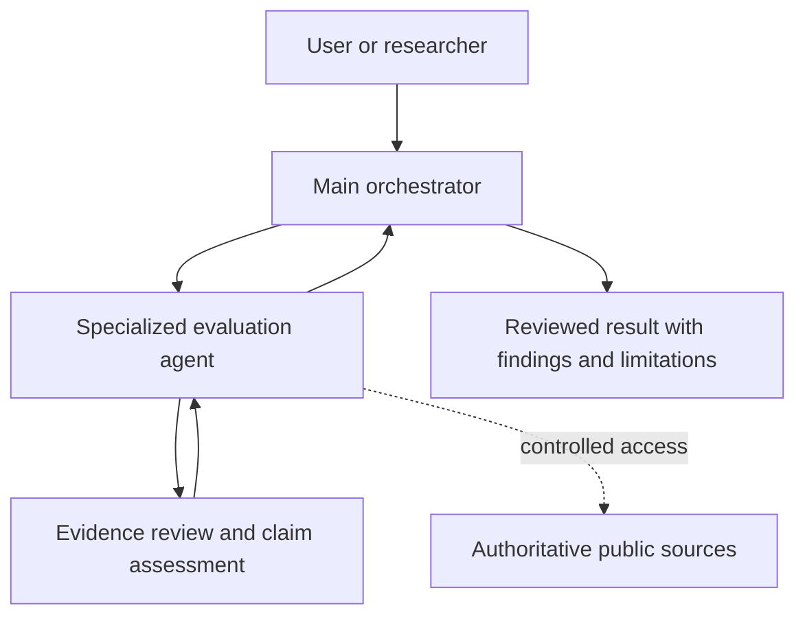

# AI Evaluation & Fact-Checking Agent

An employer-facing portfolio demonstrating the design and validation of a functional independent MVP for evaluating AI-generated answers.

## Project Summary

The project explores how a specialized AI evaluator can review another AI system's output for factual accuracy, unsupported claims, misleading interpretations, numerical inconsistencies, and evidence quality. The evaluator separates facts from interpretations, communicates uncertainty, and prioritizes authoritative evidence.

This is a functional independent MVP, not a production-certified platform or a statistically validated benchmark.

## Problem Statement

AI-generated answers can sound confident while containing incorrect dates, overbroad conclusions, weak evidence, or misleading interpretations of clinical and regulatory data. A useful evaluation system must do more than produce a second opinion: it must expose the claims being assessed, the evidence considered, and the limits of the conclusion.

## Proposed Solution

The project uses a multi-agent design. A general orchestration component interprets the request and coordinates the work, while a functionally independent evaluation component performs structured claim and evidence analysis. External evidence is accessed through a controlled gateway rather than treated as an unqualified source of truth.

## Key Achievements

- Designed and coordinated a functional two-agent MVP.
- Documented and tested two practical case studies: ANKTIVA and Leqembi.
- Reduced the core instruction configuration by 27.1%; this is not a measured token-savings result.
- Demonstrated structured claim assessment, evidence qualification, and limitation reporting.
- Produced a documented foundation for future repeatable evaluation and benchmarking.

## Evaluation Capabilities

The system is designed to support factual accuracy assessment, detection of unsupported or contradicted statements, numerical and logical consistency checks, primary-source prioritization, evidence-quality assessment, contradiction detection, adversarial reasoning, uncertainty management, and transparent reporting. Verification depth can be adapted to the complexity and consequence of the question.

These are designed capabilities. The two case studies demonstrate useful behavior, but they do not constitute a statistically meaningful benchmark or a comprehensive security assessment.

## Practical Case Studies

### ANKTIVA

The evaluation corrected the historical FDA approval date, treatment context, eligible population, product naming, and the misleading conversion of a complete-response rate into a cure rate. Subsequent review confirmed the principal factual conclusions using FDA materials. The archived test had no completed live-source verification, and a later reported run cannot be fully reconstructed.

### Leqembi

The evaluation corrected the traditional-approval date and treatment population, distinguished relative slowing of decline from improvement in cognitive function, identified the 0.45-point CDR-SB difference, and flagged significant safety risks. The observed 21.7-second duration is a single task observation, not a benchmark. The full retrieval trace was unavailable.

## Project Author's Contributions

The author defined the use case and requirements, designed the multi-agent architecture and evaluation methodology, shaped the evidence and uncertainty model, designed practical tests, coordinated implementation with AI-assisted development tools, reviewed the analytical outputs, and documented limitations. The project combines independently designed requirements, architecture and evaluation methodology with AI-assisted technical implementation.

## Demonstrated Professional Competencies

AI agent design; multi-agent orchestration; prompt and context engineering; AI response evaluation; fact-checking; evidence assessment; research-quality assurance; analytical reasoning; system validation; technical documentation; and AI-assisted development coordination.

## Current Status and Limitations

The MVP has two documented exploratory case studies. A complete tool-call and evidence trace was not preserved for every test. Resource-efficiency benchmarking, comprehensive isolation testing, and statistically meaningful evaluation benchmarking remain incomplete. The project therefore demonstrates practical design and evaluation competence while keeping its validation claims deliberately bounded.

## Portfolio Navigation

- [System Overview](System_Overview.md)
- [Evaluation Capabilities](Evaluation_Capabilities.md)
- [ANKTIVA Case Study](ANKTIVA_Case_Study.md)
- [Leqembi Case Study](Leqembi_Case_Study.md)

### Intellectual Property Notice

This repository is a professional portfolio showcasing the capabilities, architectural concepts, and evaluation results of an independently developed AI system.

The underlying implementation, agent instructions, configuration, and internal evaluation methodology are not publicly disclosed.

All rights reserved for original authored materials. Third-party referenced materials remain subject to their respective rights.

