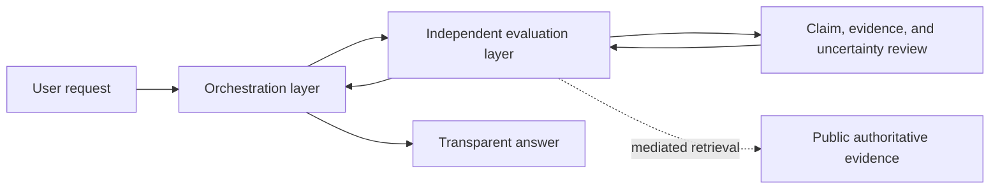

# System Overview

## Conceptual Architecture

The project uses a two-level multi-agent architecture. A main orchestrator manages the interaction and coordinates work. A specialized evaluation component performs independent analysis of AI-generated answers and returns findings for review and communication.

## Design Principles

- Separate coordination from independent analysis.
- Make claims and evidence visible rather than relying on confidence alone.
- Use modular instructions so specialized expertise can be applied when needed.
- Prefer authoritative and primary evidence where available.
- Treat uncertainty, missing evidence, and conflicting sources as reportable results.
- Apply controlled access boundaries to external information.
- Distinguish demonstrated behavior from expected optimization and unvalidated assumptions.

## Why Multi-Agent Architecture?

Separating orchestration from evaluation reduces the risk that the component responsible for satisfying the user also acts as the only reviewer of its own answer. It also creates a clearer boundary for testing, specialized reasoning, and future expansion. The evaluator remains functionally independent from research departments in the conceptual design.

## Information Access

The evaluator can be connected to public evidence through a managed gateway. This arrangement supports source discovery and retrieval while keeping access controlled and making the distinction between the agent's reasoning and external evidence explicit. Search results are not automatically treated as proof; important claims require source and context assessment.

## Security and Reliability Principles

The internal implementation uses layered isolation and restricted access, but this public document intentionally omits exact settings, internal paths, credentials, prompt content, and operational procedures. The project is not presented as security-certified. Reliability work includes backups and recovery planning, while full restoration and comprehensive isolation validation remain areas for further testing.

## Scalability

The same separation can support additional domain-specific research components in the future. Any such expansion is planned rather than implemented. The core evaluation function should remain directly connected to the orchestration layer so that independent checking is not subordinated to a domain research workflow.

